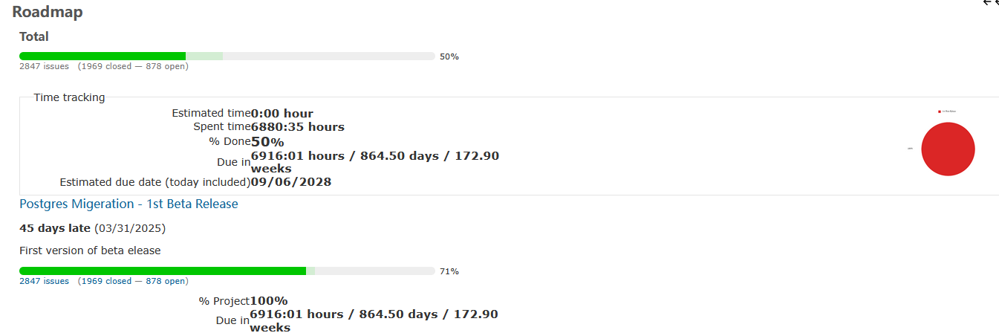

Redmine Plugin: Advanced Roadmap v4
===================================

This plugin is a modern fork of Redmine Plugin: [advanced roadmap](https://redmine.ociotec.com/projects/advanced-roadmap).

Screenshot
==========




Features in v4
==============

The Advanced Roadmap v4 plugin for Redmine provides:

1. **Enhanced Roadmap View:**
   * Total project metrics displayed at the top with overall completion and estimated completion dates.
   * Detailed breakdown per version with exact progress, rest hours, and parallel effort calculations.
   * Status color-coding (red: overdue, orange: warning/behind schedule, black: normal, green: ahead of schedule).
   * **Milestone Filter Bar:** Quick interactive filter pills on the Roadmap page to filter versions by milestone.

2. **Milestones Feature & Risk Analysis:**
   * Group and track multiple versions across projects under unified Milestones.
   * **Status Badges & Overdue / At-Risk Alerts:** Real-time badges (`Closed`, `Open`, `Overdue`, `At Risk`) indicating whether velocity projections will breach milestone due dates.
   * Milestone management via Project Settings tab.

3. **Modern Visual Analytics (Zero C-Library Dependencies):**
   * High-resolution, interactive client-side SVG donut charts and breakdown cards.
   * No external server-side RMagick or Gruff ImageMagick requirements.

4. **Exports & Automation:**
   * **CSV Export:** Download full Milestone metrics, version breakdowns, and hours with a single click.
   * **REST API:** Supports `/projects/:project_id/milestones.json` and `/milestones/:id.json` for CI/CD, bot, or dashboard integrations.


Installation
============

1. Clone into your Redmine `plugins` directory:

   ```bash
   cd /path/to/redmine/plugins
   git clone https://github.com/Arean82/advanced_roadmap.git
   ```

2. From your Redmine root directory, configure bundler and install gem dependencies:

   ```bash
   cd /path/to/redmine
   bundle config set --local without 'development test'
   bundle install
   ```

3. Run the plugin database migrations:

   ```bash
   bundle exec rake redmine:plugins:migrate RAILS_ENV=production
   ```

4. Restart your Redmine application server:

   ```bash
   sudo systemctl restart redmine
   ```


Compatibility
=============

* Compatible with Redmine 5.x and Redmine 6.x / 7.x (Rails 7 / Zeitwerk).
* Tested on Redmine 7.0.3 production environment.
